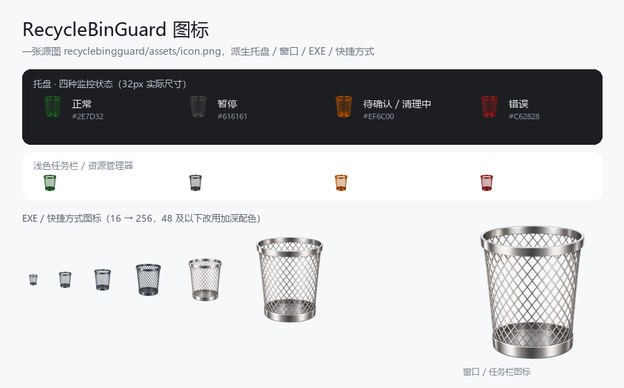

# RecycleBinGuard

Windows 10 回收站后台监控与自动清理工具。

> 需求基线见 [PRD.md](./PRD.md)。本仓库按 **T1 → T2 → T3 → T4 → T5** 分阶段实现，
> T1–T4 已全部完成，T5 剩余项需人工在专用环境执行（见 [ACCEPTANCE.md](./ACCEPTANCE.md)）。

## 它做什么

后台每 600 秒（10 分钟，可配置）检查一次 Windows 回收站项目总数与占用大小，
达到任一阈值（默认 10,000 个项目）时清理整个回收站。自动清理**默认开启**，
且每次清理前仍会先弹一次确认窗（可在设置里关闭）。

阈值、检查间隔、是否按占用大小触发、要排除哪些磁盘，都可以在**托盘 → 设置…**
里直接修改，无需手改 JSON。

## 它不做什么

- 除**自动升级检查**（拉取 GitHub Releases 公开库、无令牌）外，不做其他网络请求、遥测或大模型调用；清理功能本身完全离线；
- 不做数据库 / Web 界面 / 云同步；
- 不直接遍历或删除 `$Recycle.Bin` 下的 `$I` / `$R` 文件；
- 默认不需要管理员权限。

## 安全默认值

| 配置项 | 默认值 | 含义 |
| --- | --- | --- |
| `auto_clean_enabled` | `true` | 首次安装即开启自动清理；每次清理前仍会弹确认框 |
| `auto_clean_confirmed` | `false` | 是否已确认过不可逆删除风险（关闭后再启用前必须确认） |
| `confirm_before_clean` | `true` | 达到阈值后先弹确认窗；关闭则回到“无需逐次确认”的自动清理 |
| `confirmation_timeout_seconds` | `10` | 确认窗倒计时：`>0` 归零后进入复核并清理；`0` 不自动，一直等用户 |
| `auto_update_on_signal` | `true` | 发现 GitHub 新版本 / 本地升级信号时自动下载并换包 |
| `threshold_items` | `10000` | 项目数触发阈值 |
| `threshold_size_bytes` | `0` | 占用大小触发阈值（字节）；`0` = 不启用 |
| `poll_interval_seconds` | `600` | 轮询间隔（10 分钟） |
| `failure_backoff_seconds` | `300` | 失败退避 |
| `excluded_roots` | `[]` | 不统计、也不清空的盘符（如 `["D:\\"]`） |
| `start_on_login` | `false` | 登录后自动启动（静默驻留托盘） |
| `hotkey_enabled` | `true` | 全局热键 Ctrl + Alt + R 唤出状态窗口 |
| `clean_sound_enabled` | `true` | 清理成功后播一声提示音（打包的 `assets/trash.wav`） |
| `theme` | `"auto"` | 界面皮肤：`auto`（按系统时间自动）/ `light` / `dark` |

> `dry_run` 试运行模式已移除：程序要么经你确认后真清理，要么保持只监控。

> 统计不完整（任一固定磁盘查询失败）时，程序**选择不清理**，绝不把未知磁盘当成 0。

## 目录结构

```
RecycleBinGuard/
├── PRD.md                     # 产品需求文档（需求基线）
├── README.md
├── ACCEPTANCE.md              # 真实清空人工验收手册（T5）
├── build.py                   # 一键构建（测试 → 图标 → PyInstaller → 冒烟）
├── requirements.txt           # 运行依赖
├── requirements-dev.txt       # 开发/测试/打包依赖（含 ruff / mypy）
├── pyproject.toml             # 打包、pytest、ruff、mypy 配置
├── config.example.json        # 配置示例（与默认值逐项一致，有测试守护）
├── .github/workflows/ci.yml   # CI：ruff + mypy + pytest（Windows）
├── packaging/
│   ├── launcher.py            # PyInstaller 入口（绝对导入，避免相对导入失败）
│   └── RecycleBinGuard.spec   # PyInstaller 单文件（onefile）构建配置
├── tools/
│   └── make_icon.py           # 由 assets/icon.png 生成多尺寸 packaging/recyclebingguard.ico
├── recyclebingguard/          # 主包
│   ├── __init__.py
│   ├── assets/                # 图标资源（全项目唯一来源，见“图标”一节）
│   │   └── icon.png           # 不锈钢菱形网格废纸篓（透明背景 512×512）
│   ├── assets.py              # 图标资源定位与加载（源码 / PyInstaller 两种形态）
│   ├── __main__.py            # 入口：单实例、日志、托盘启动、卸载/自启命令
│   ├── paths.py               # 应用数据目录 / 日志 / 锁文件路径
│   ├── config.py              # 配置模型与读写（默认安全配置）
│   ├── logging_setup.py       # 轮转日志
│   ├── interfaces.py          # 核心接口与数据类型定义
│   ├── recycle_bin_service.py # T1：回收站统计与清空核心（Shell API）
│   ├── recycle_bin_monitor.py # T2：阈值监控与安全状态机
│   ├── confirmation.py        # 清理前确认的请求 / 决策契约（与 UI 无关）
│   ├── confirm_dialog.py      # 清理前确认弹窗（tkinter，三行小卡片，右下角升起 / 降下）
│   ├── sound.py               # 清理音效（打包的 trash.wav，资源缺失时降级为合成波形）
│   ├── appearance.py          # 皮肤取值与“跟随系统时间”判定（纯逻辑，不含 tkinter）
│   ├── theme.py               # 浅色 / 深色配色、ttk 样式与自绘控件（卡片 / 开关 / 圆环）
│   ├── single_instance.py     # T3：操作系统级单实例锁 + 唤醒已有实例
│   ├── app.py                 # T3：应用控制器（与 UI 无关）
│   ├── tray.py                # T3：pystray 托盘 + tkinter 状态窗口
│   ├── settings_dialog.py     # T3：设置对话框（阈值 / 间隔 / 排除盘符 / 皮肤）
│   ├── hotkey.py              # T3：全局热键 Ctrl+Alt+R（RegisterHotKey）
│   ├── shortcuts.py           # T3：开始菜单 / 桌面快捷方式
│   └── autostart.py           # T4：当前用户登录启动项
└── tests/                     # pytest 测试
```

> 运行时会在程序目录生成 `config.json`、`logs/`、`clean_history.json`、
> `RecycleBinGuard.lock`、`wake.request`、`update.signal`、`crash.log`，这些**都不入库**（见 `.gitignore`）。

## 环境准备

```powershell
python -m venv .venv
.\.venv\Scripts\Activate.ps1
python -m pip install -r requirements-dev.txt
```

## 运行测试

```powershell
python -m pytest -q
```

## 静态检查

```powershell
python -m ruff check .        # 代码风格 / 潜在缺陷
python -m ruff format --check .   # 格式（需要时用 python -m ruff format . 一键格式化）
python -m mypy                # 类型检查（仅主包）
```

三者与 `pytest` 一起在 `.github/workflows/ci.yml` 里对 Python 3.11 / 3.12 执行。

## 数据与日志位置

**默认全部放在程序所在目录**，便于就地查看与编辑：

- 源码运行：项目根目录（`D:\RecycleBinGuard\`）；
- 打包后：`RecycleBinGuard.exe` 所在目录。

| 文件 | 用途 |
| --- | --- |
| `config.json` | 用户配置 |
| `logs/recyclebingguard.log` | 轮转日志 |
| `clean_history.json` | 清理历史（缓存） |
| `RecycleBinGuard.lock` | 单实例锁 |
| `wake.request` | 唤醒已有实例的请求文件 |
| `update.signal` | 本地升级信号（离线兜底的自动升级来源） |
| `crash.log` | 崩溃兜底日志 |

> **注意**：如果把 EXE 放进只读目录（例如 `Program Files`），写配置与日志会失败。
> 此时可用环境变量 `RECYCLEBINGUARD_HOME` 指向可写目录；
> 测试同样用它隔离，避免污染真实项目目录。

`config.json` 损坏（非法 JSON 或取值越界）时**不再阻塞启动**：程序会把原文件改名备份为
`config.json.bad-<时间戳>`，回退到默认配置并重新写入，同时把原因写进日志与 `--report`。

> **清理历史是什么**：记录「每一次真正调用过清空 API 的清理」（成功 / 部分 / 失败 / 异常都记，含时间、清理前后数量、触发方式、耗时、错误信息），程序重启后仍可查询。轮转日志会被覆盖、`last_clean_result` 只存内存，因此单独用结构化 JSON 文件持久化「上一次达到阈值并执行清理是什么时候」。详细说明见 T2 的「清理历史」小节。

## T1：回收站统计与清空核心（`recyclebingguard/recycle_bin_service.py`）

### 使用的 Windows API

| API | 用途 |
| --- | --- |
| `SHQueryRecycleBinW` | 查询**单个盘符**回收站的项目数（`i64NumItems`）与占用字节（`i64Size`） |
| `SHEmptyRecycleBinW` | 清空**指定盘符**的回收站 |
| `GetLogicalDrives` / `GetDriveTypeW` | 枚举盘符并判定磁盘类型 |

清空标志固定为 `SHERB_NOCONFIRMATION \| SHERB_NOPROGRESSUI`（不弹系统确认框、不显示进度对话框），
并使用 `SHERB_NOSOUND` 之外的默认行为；刻意**不使用任何“静默错误”式标志**，错误由本模块显式处理与上报。

### 统计口径

- 逐盘查询后求和，单盘计数取 `SHQUERYRBINFO.i64NumItems`，占用字节取 `i64Size`；
- 只统计**本机固定磁盘**（`DRIVE_FIXED`）；可移动盘 / 网络盘 / 光驱 / 内存盘 / 未挂载卷不纳入；
- `excluded_roots` 中列出的盘符既不统计、也不清空（`set_excluded_roots()` 可在运行时更新）；
- 不使用 `$Recycle.Bin` 目录内 `$I` / `$R` 的文件数量；
- 结果同时包含总数、总占用、成功磁盘、失败磁盘、查询时间与每个磁盘的明细；
- **任一应纳入磁盘查询失败，或一个固定磁盘都没枚举到** → `is_complete == False`，
  `should_trigger()` 恒为 `False`，绝不会把未知磁盘当成 0。

### 清空行为与安全边界

1. **清空前二次核验**：复核统计不完整时直接返回 `INCOMPLETE`，**不调用**清空 API；
   监控器刚做过的复核可通过 `empty(verified_scan=...)` 复用，避免重复扫描（安全性不变）；
2. **逐盘清空**：对每个已纳入统计的固定磁盘调用 `SHEmptyRecycleBinW(root)`，
   刻意**不传 `NULL`**（`NULL` 会波及本次未统计的可移动盘与网络盘）；
3. **清空后复核**：重新统计并以此为准判定结果；
4. 结果类型：

| 结果 | 触发条件 |
| --- | --- |
| `SUCCESS` | 复核后总数为 0 |
| `PARTIAL` | 部分磁盘清空成功，复核后仍有项目（**不重复清空**） |
| `FAILED` | 所有磁盘清空调用均失败，且复核后仍有项目 |
| `INCOMPLETE` | 清空前或清空后统计不完整，结果未确认 |

`CleanResult` 同时返回 `hresult`、`duration_seconds`、`items_before`、`items_after`、`remaining_items` 与 `error`。

### 已知限制

- 仅支持盘符（`C:\` 等）；通过文件夹挂载的卷（volume mount point）不纳入；
- 计数来自 Shell 接口，与资源管理器“回收站属性”同一来源，但不保证与界面上每一种统计口径完全一致；
- 不保证清空耗时——Windows 原生清空速度受文件数量、磁盘性能与文件系统状态影响；
- 本模块不含定时器、托盘 UI 与开机启动逻辑（分属 T2 / T3 / T4）。

### 测试方式

```powershell
python -m pytest tests/test_recycle_bin_service.py -q
```

- **默认全部使用 fake API**（`FakeShellApi`）隔离 Windows API，可在任何平台运行；
- 覆盖：多盘求和、可移动/网络盘排除、单盘失败、负数计数、无固定磁盘、
  API 错误、清空失败 / 部分失败 / 复核失败、清空后不重复重试、标志位与结构体布局；
- **真实 API 仅做只读验证**（`test_real_api_readonly_scan`）：枚举磁盘 + `scan()`，
  **绝不执行真实清空**，也绝不会清空开发者当前的真实回收站。

真实统计交叉核验示例（只读，可复现）：

```powershell
# 本工具
python -c "from recyclebingguard.recycle_bin_service import RecycleBinService; print(RecycleBinService().scan().total_items)"
# 独立口径：Shell.Application 回收站命名空间
$shell = New-Object -ComObject Shell.Application; $shell.Namespace(0xA).Items().Count
```

## T2：阈值监控与安全状态机（`recyclebingguard/recycle_bin_monitor.py`）

### 默认安全配置

| 键 | 默认值 | 说明 |
| --- | --- | --- |
| `threshold_items` | `10000` | 项目数触发阈值 |
| `threshold_size_bytes` | `0` | 占用大小触发阈值（字节）；`0` = 不启用 |
| `poll_interval_seconds` | `600` | 轮询间隔（10 分钟） |
| `auto_clean_enabled` | `true` | **首次安装即开启**，每次清理前仍弹确认窗 |
| `confirm_before_clean` | `true` | 达到阈值后先弹确认窗（见下节） |
| `confirmation_timeout_seconds` | `10` | 确认窗倒计时秒数，`0` = 不自动 |
| `failure_backoff_seconds` | `300` | 失败退避 |
| `excluded_roots` | `[]` | 不统计、也不清空的盘符 |
| `clean_sound_enabled` | `true` | 清理成功后播一声提示音，`false` 静音 |

### 触发流程

1. 每 `poll_interval_seconds` 秒调用一次 `service.scan()`；
2. 统计不完整（`is_complete == False`）→ 只记录，本轮不做任何清理、**不弹窗**；
3. 两条阈值都不满足（项目数 `< threshold_items` **且** 占用 `< threshold_size_bytes`）→ 继续监控；
4. 满足任一阈值 → 状态 `THRESHOLD_REACHED`；
5. 若自动清理未启用或已暂停 → 仅记录；
6. 若处于失败退避期 → 等待退避结束；
7. 若 `confirm_before_clean` → 状态 `AWAITING_CONFIRMATION`，请求确认弹窗（**监控线程不等待**）：
   - 取消 / 关闭窗口 / 程序退出 / 暂停 → 本轮放弃，清理 API 调用次数为 0；
   - 倒计时归零或点击「立即清理」→ **重新统计复核**；
   - 复核不完整或未达阈值 → 放弃本轮并记录原因；
8. **复核通过** → 状态 `CLEANING` → 调用 `service.empty(verified_scan=复核结果)`
   （内部含清空前复核与清空后复核，复核结果直接复用，少扫一遍）；
9. 状态 `VERIFYING` → 再次统计并记录；
10. 清理成功 → `IDLE`；非 `SUCCESS`（`PARTIAL` / `FAILED` / `INCOMPLETE`）→ `ERROR` 并退避 300 秒；
11. 下一轮仍达阈值时可以再次弹窗。

### 清理前确认弹窗（`confirmation.py` + `confirm_dialog.py`）

一张**小卡片**（实测 402×144），右上角三行说清一件事：_回收站已触发清理，要不要清？_

| 项 | 行为 |
| --- | --- |
| 标题 | `RecycleBinGuard — 回收站清理确认` |
| 内容 | 只有三样：`回收站已触发清理` / `12,345 项将被永久删除` / 倒计时（`10 秒后自动清理`） |
| 刻意不显示 | 阈值、超出量、大段风险说明——那是设置窗口与说明文档的职责，弹窗只负责让人一秒做决定 |
| 按钮 | 「取消」/「清理」；**没有默认按钮**，回车不会确认 |
| 关闭窗口 | 等同取消 |
| 倒计时 | `after()` 每秒刷新 `10…1`，归零后进入复核流程（不是直接清理） |
| 出现方式 | 像系统通知一样出现在**屏幕右下角**（避开任务栏）：从屏幕下缘**缓缓升起**到位（约 260ms） |
| 倒计时到点 | 先向下**缓缓降下**离开屏幕，动画播完才把 `timeout` 决定交给上层进入复核 |
| 主动操作 | 点按钮 / 关闭窗口**立即**收窗，不做动画（保证响应快） |
| 动画与安全 | 决定在动画开始前就已**锁定**：降下期间再点取消 / 关闭 / 退出都**不会**产生第二个决定；外部 `abort()` 会立即送达已锁定的决定 |
| `confirmation_timeout_seconds = 0` | 不倒计时，弹窗一直等用户 |
| 同一时刻 | 最多一个弹窗、一个待确认请求、一个清理任务 |
| 线程 | 弹窗只在 UI 主线程创建与更新；复核与清理在后台线程执行；动画用 `after()` 逐帧驱动，**不阻塞**主线程 |

每次请求带一个单调递增的 `token`：**过期、重复、取消后、退出后、暂停后**的决定一律丢弃，
绝不产生“残留任务仍然清理”或“点一次按钮清理两次”。

> 落位说明：弹窗要在显示前就知道自己多高，而卡片控件的高度是按内容算出来的，
> 所以显示前会先 `sync_cards()` 同步一次尺寸（`theme.py`），避免窗口先按错误高度
> 落位再自己收缩（看起来像“闪一下再跳过去”）。

### 清理音效（`sound.py`）

清理**成功或部分成功**后播一声，默认是 macOS「倒垃圾」风格的提示音（由用户提供的 MP3
经 `tools/convert_trash_sound.py` 转成的 `assets/trash.wav`，随包分发）。

| 项 | 行为 |
| --- | --- |
| 声音来源 | 打包的 **WAV 资源**（`recyclebingguard/assets/trash.wav`，单声道 16-bit / 44100Hz） |
| 兜底 | 若该资源因故缺失，降级为 `render_trash_samples()` 运行时合成的波形，保证仍有声音 |
| 播放方式 | `winsound.PlaySound(..., SND_MEMORY)`，跑在守护线程里——**清理线程一秒都不等** |
| 失败处理 | 没有 `winsound`、非 Windows、设备被占用……一律只写一行 debug 日志，**绝不影响清理** |
| 触发时机 | 清空 API 返回 `success` / `partial` 之后（失败不发声，避免误导） |
| 关闭 | `config.json` 里 `clean_sound_enabled: false` |

> 想换成自己的音效：把 MP3 准备好，运行 `python tools/convert_trash_sound.py "路径/音效.mp3"`
> 即可重新生成 `assets/trash.wav`，无需改任何代码；播放链路（异步、兜底、静音开关）都不用动。
>
> 音频栈的首次初始化由 Windows 负责，第一次播放可能晚 0.6~0.9 秒才出声，属正常现象。

### 状态机

`IDLE` → `CHECKING` → `THRESHOLD_REACHED` → `AWAITING_CONFIRMATION` → `CLEANING` →
`VERIFYING` →（`IDLE` / `ERROR`），任意时刻可通过 `pause()` 进入 `PAUSED`，`resume()` 回到 `IDLE`。

### 并发与残留任务

- `tick()` / `_clean()` 均在可重入锁内检查 `_cleaning` 标志，**同一时刻只有一个清理任务**；
- 监控只有一个后台线程，不存在“队列”，因此暂停或关闭自动清理后**不会执行残留清理**；
- `_clean()` 在真正调用 `empty()` 前会再次检查 `PAUSED` 与 `auto_clean_enabled`；
- 后台线程内的任何异常都会被捕获、记入 `last_error`、进入 `ERROR` 并退避，**不会静默吞掉**。

### 编程接口

```python
from recyclebingguard.config import load_config
from recyclebingguard.recycle_bin_monitor import RecycleBinMonitor
from recyclebingguard.recycle_bin_service import RecycleBinService

monitor = RecycleBinMonitor(RecycleBinService(), load_config())
monitor.start()  # 后台轮询
monitor.status()  # MonitorStatus 快照，供 UI 使用
monitor.check_now()  # 立即执行一次检查
monitor.pause() / resume()
monitor.set_auto_clean_enabled(True)  # 关闭后本轮的清理会被拒绝
monitor.stop()  # 停止并回收线程
```

### 测试方式

```powershell
python -m pytest tests/test_recycle_bin_monitor.py tests/test_confirmation.py -q
```

- 使用 fake 服务 + 假时钟，不等待真实时间，也**不触碰真实回收站**；
- 覆盖：9999 / 10000 / 10001 边界、统计不完整不触发、
  自动清理关闭 / 暂停不清理、二次核验取消清理、清理期间不并发、
  失败退避后才重试、同一轮不重复清理、成功后重新统计、异常不静默、
  线程启动 / 停止 / 重复启动 / 幂等停止。

`tests/test_confirmation.py` 另外覆盖清理前确认弹窗：9999 不弹 / 10000、10001 弹、
确认只清理一次、取消 / 关闭 / 复核失败 / 复核低于阈值一律 0 次清理、
两个周期最多一个弹窗、退出或暂停后过期决定不清理、倒计时逐秒更新与归零进复核、
配置为 0 或非法值不自动清理、弹窗只用 `after()` 且不阻塞 UI，
以及右下角落位与升降动效（升起轨迹、降下后才交付 `timeout` 决定、
降下期间点击不改变已锁定的决定、`abort()` 立即送达、无动画模式同步交付）。

`tests/test_sound.py` 覆盖清理音效：加载打包 WAV（RIFF/WAVE、16-bit 单声道、缓存复用）、
合成兜底的波形长度与归一化、合成确定性、能量随时间衰减、静音开关、非 Windows 静默、
同步 / 异步播放路径、播放抛异常被吞掉，以及"清理成功才响、配置关闭就不响"的接线。
测试期间 `conftest.py` 有全局静音夹具，跑测试**不会真的发声**。

### 清理历史（记录「上一次执行清理是什么时候」）

每次**真正调用了清空 API** 的清理，都会被追加写入
`clean_history.json`（与轮转日志同目录，便于跨重启回答“上一次清理是什么时候”）：

- 记录字段：完成时间、结果类型（`success`/`partial`/`failed`/`incomplete`）、触发方式
  （`confirmed`=点立即清理 / `timeout`=倒计时归零 / `auto`=未开弹窗的自动 / `error`=清理中异常）、
  清理前 / 后数量、触发阈值、耗时、错误信息；
- **不记录任何文件名或文件内容**；
- **不写入**的情形：取消确认、复核未通过、清理未真正调用 API；
- 文件损坏 / 格式非法时返回空历史并记日志，**不抛异常、不影响监控**；
- 原子写入（先写 `.tmp` 再 `replace`），最多保留 `MAX_RECORDS=50` 条；
- 可通过 `AppController.last_clean_summary()` / `recent_cleans()` 查询；状态窗口新增「上次清理」行、托盘菜单新增「查看清理历史」。

```python
from recyclebingguard.recycle_bin_monitor import RecycleBinMonitor

monitor = RecycleBinMonitor(RecycleBinService(), load_config())
print(monitor.last_clean_record())  # 最近一次（含失败），首次从磁盘加载
print(monitor.last_successful_clean())  # 最近一次成功
```

相关测试见 `tests/test_clean_history.py`（覆盖记录往返、成功 / 失败 / 异常均落盘、
取消 / 复核失败不落盘、跨重启可读回、文件损坏降级、写入失败返回 False 等）。

## T3：系统托盘与状态窗口

模块：`single_instance.py`（锁 + 唤醒）、`app.py`（控制器）、`tray.py`（界面）、
`hotkey.py`（全局热键）、`shortcuts.py`（快捷方式）、`__main__.py`（装配）。

### 打开方式（四种入口）

Windows 10 的托盘图标经常被折叠进“隐藏的图标”区域，因此程序提供四种确定的打开方式：

| 入口 | 说明 |
| --- | --- |
| **桌面 / 开始菜单快捷方式** | `--install-shortcuts` 创建；双击即启动，或唤醒已有实例 |
| **全局热键 `Ctrl + Alt + R`** | 程序运行时随时唤出状态窗口，可在托盘菜单里关闭（默认开启） |
| **重复启动即唤醒** | 已在运行时再双击，不再弹“已运行”提示，而是**直接把已有窗口显示出来** |
| **托盘图标** | 右键菜单 → 打开状态窗口（是菜单默认项，左键单击也触发） |

登录自启时（`--start-minimized`）静默驻留托盘不弹窗；用户双击快捷方式时才会显示窗口。
重复唤醒用 `wake.request` 这个请求文件实现（与配置、日志同目录）：
不需要 IPC、不需要权限，进程被强杀后最多残留一个无用文件，会被自动消费掉。

### 托盘右键菜单

| 菜单项 | 行为 |
| --- | --- |
| 打开状态窗口 | 默认项（左键单击也触发） |
| 立即检查 | 派发到后台线程，UI 不冻结 |
| 设置… | 打开设置对话框：项目数阈值 / 占用大小阈值 / 检查间隔 / 排除盘符 / **开机启动** / 界面皮肤 |
| 皮肤：跟随系统时间（当前浅色） | 手动换肤，按 `跟随系统时间 → 浅色 → 深色` 循环，写入 `theme` |
| 启用 / 关闭自动清理 | 关闭后再启用前弹不可逆删除风险说明并需明确确认 |
| 打开热键（Ctrl + Alt + R） | 勾选项，对应 `hotkey_enabled` |
| 安装开始菜单 / 桌面快捷方式 | 一键创建启动入口，创建结果弹窗反馈 |
| 查看最近清理日志 | 弹出日志窗口，读取轮转日志尾部 |
| 查看清理历史 | 弹出窗口，列出 `clean_history.json` 中的历次清理（时间 / 结果 / 触发方式 / 数量 / 错误），程序重启后仍可读 |
| 检查更新 | 立即检查 GitHub Releases 是否有新版本（忽略 6 小时间隔） |
| 安装更新 | 发现新版本后：后台下载并校验 sha256，再换包重启 |
| 开机启动设置 | 勾选项，对应 `start_on_login`；并自愈残留/缺失的启动项 |
| 退出程序 | 停止监控线程与后台执行器，不残留任务 |

### 状态窗口

顶部是**状态卡**：状态徽标（正在监控 / 已暂停 · 自动清理已启用 / 已关闭 ·
统计不完整 · 清理失败）、大字号项目总数，以及一条“距阈值”进度条；下方是「运行概览」
（阈值、最近 / 下次检查、最近清理结果、上次清理、开机启动、最近错误、配置路径）、「选项」
（自动清理的开关）与操作按钮
（立即检查 / 暂停·恢复 / 查看日志 / 设置… / 皮肤 / 隐藏窗口 / 退出）。
概览里的值带语义配色：成功绿、失败红、提醒橙、中性灰。

「下次检查」显示的是**真实剩余秒数**（`AppController.seconds_until_next_check()`）：
已计入失败退避与上一轮清理耗时，不再固定回显轮询间隔。

### 界面皮肤（`recyclebingguard/appearance.py` + `theme.py`）

| 模式 | 行为 |
| --- | --- |
| `auto`（默认） | 按**系统时间**自动切换：`07:00–18:59` 浅色，其余时间深色；跨过分界最多 30 秒内自动换肤 |
| `light` | 固定浅色（浅灰底 + 白卡片 + 蓝色强调） |
| `dark` | 固定深色（深灰底 + 深色卡片） |

- **手动换肤**：状态窗口的「皮肤：…」按钮或托盘菜单同名项，按
  `跟随系统时间 → 浅色 → 深色 → 跟随系统时间` 循环，写入 `config.json` 的 `theme`；
  设置对话框里也可用下拉框直接选。
- **在线换肤**：不需要重开窗口或重启程序，切换后主窗口、设置对话框、清理确认弹窗
  同时刷新（配色集中在 `theme.PALETTES`，ttk 样式全局生效）。
- 皮肤判定（模式取值、白天 / 夜间小时数、`mode_label`、`next_mode`）在
  `appearance.py`，**不导入 tkinter**，因此控制器可以在无图形环境下单测；
  `theme.py` 只负责“把某个皮肤画出来”。
- 使用 ttk 的 `clam` 基础主题（`vista` 会用系统外观覆盖自定义颜色），并自绘了
  圆角卡片、开关、进度条、环形倒计时等控件（tkinter 原生没有这些）。
- 卡片控件的高度按内容算出（`Canvas` 默认请求尺寸很大，显示前会调
  `sync_cards()` 同步一次），因此右下角弹窗能在**映射前**就知道自己多高并准确落位。
- 皮肤只影响外观，**不影响任何安全行为**：倒计时归零仍进入复核、仍不设置回车默认
  确认、取消后仍继续监控。

### 设置对话框（`recyclebingguard/settings_dialog.py`）

托盘菜单「设置…」或状态窗口「设置…」按钮打开，可在界面里直接修改：

| 字段 | 对应配置 | 校验 |
| --- | --- | --- |
| 触发阈值（项目数） | `threshold_items` | `>= 1` |
| 占用大小阈值（MB） | `threshold_size_bytes` | `>= 0`，`0` = 不启用 |
| 检查间隔（秒） | `poll_interval_seconds` | `>= 1` |
| 排除的盘符 | `excluded_roots` | 逗号分隔，需形如 `D:` |
| 开机启动 | `start_on_login` | 开关；写 `HKCU\...\Run`，仅 Windows |
| 界面皮肤 | `theme` | 下拉选择：跟随系统时间 / 浅色 / 深色 |

保存时统一走 `AppController.apply_settings()`：先整体校验，**任一项非法就整批拒绝**
（提示且不关闭窗口），合法则就地更新共享配置、同步给服务层并原子写盘。
新值在下一轮检查时生效（间隔从下一轮开始使用新值），无需重启。

**开机启动**是唯一会写注册表的设置项，因此单独处理（`_apply_start_on_login()`）：

- 开关初值取自**注册表实际状态**（而非配置值），避免显示与真实状态不一致；
- 只有在用户**真的改了开关**时才调用 `AppController.set_start_on_login()` 写
  `HKCU\Software\Microsoft\Windows\CurrentVersion\Run`，没动就一个字节都不写
  （否则“打开设置 → 保存”会顺手删掉用户已有的启动项）；
- 写入未生效（权限 / 安全软件拦截）时把开关拨回真实状态、提示并**保持窗口打开**；
- 非 Windows 平台开关置灰并说明原因。


窗口顶部一行用标签明确区分：**正在监控 / 已暂停 · 自动清理已启用 / 已关闭 ·
统计不完整 · 清理失败**（`AppController.state_labels()`，可单测）。

### 线程模型

- `tkinter` 只能主线程使用 → `mainloop` 在主线程；
- `pystray.Icon.run` 在守护线程；
- 托盘菜单回调运行在 pystray 线程，**不直接操作控件**，而是把闭包投入
  `queue.Queue`，由主线程每 500ms 取出执行（tkinter 唯一线程安全的做法）；
- 耗时操作（检查 / 复核 / 清空）由 `AppController` 的**单线程执行器**在后台运行；
- 清理确认弹窗走同一条通道：监控线程 → `AppController.request_clean_confirmation()`
  → UI 队列 → 主线程创建弹窗；用户决定再回到后台线程执行复核与清理，
  **弹窗等待期间 UI 不阻塞**（弹窗不使用 `grab_set()` / `wait_window()`）。

### 单实例

使用操作系统级文件锁（Windows `msvcrt.locking`），不是“锁文件存在与否”判断：

- 进程无论正常退出还是被强杀，操作系统都会释放锁 → **异常终止可自恢复**；
- 重复启动时不再无限弹窗，而是**先唤醒已有实例**（把它的状态窗口显示出来），
  唤醒失败才退回提示并退出（退出码 3），不会创建第二个监控实例。

> **踩过的坑**：`msvcrt.locking` 是**强制锁**，不是劝告锁。已有实例锁住字节区间后，
> 第二个进程连 `os.open(锁文件, O_CREAT | O_RDWR)` 都会被拒绝（`PermissionError` Errno 13）。
> 早期版本这一行是裸调用，异常会一路冒泡导致**进程崩溃**（写 `crash.log`），
> 于是根本走不到“唤醒已有实例”那一步——而这在 onefile EXE 形态下是每次重复启动必崩。
> 现在 `acquire()` 把 PermissionError / OSError 一律当作“已有实例在运行”返回 `False`：
> 打不开锁时宁可不启动，也绝不冒“两个实例同时清理回收站”的风险。
> 覆盖用例见 `tests/test_single_instance.py`（含真实跨进程持锁的场景）。

### 配置持久化

所有用户配置存放在**程序目录**下的 `config.json`，原子写入（先写 `.tmp` 再 `replace`）。
测试可用环境变量 `RECYCLEBINGUARD_HOME` 覆盖目录，避免污染真实项目目录。

配置损坏时启动不再失败：`config.json` 会被改名备份为 `config.json.bad-<时间戳>`，
程序回退到默认配置并重新写入（见 `__main__._load_config_with_recovery()`）。

## T4：开机启动与 EXE 打包

### 开机启动

实现方式：写当前用户的
`HKCU\Software\Microsoft\Windows\CurrentVersion\Run` 注册表值（`recyclebingguard/autostart.py`）。

- **仅当前用户**，不需要管理员权限，不需要 COM / pywin32；
- 卸载 = 删除该值，干净可查；用户也可在“任务管理器 → 启动”中自行禁用；
- 使用 `HKLM`、任务计划程序、自动提权——**均不采用**；
- 命令形式：
  - 打包后：`"<安装路径>\RecycleBinGuard.exe"`
  - 开发环境：`"<pythonw.exe>" -m recyclebingguard`

### 构建

```powershell
python build.py                # 测试 → 生成图标 → PyInstaller → 冒烟验证
python build.py --skip-tests
```

- 采用 **单文件（onefile）** 构建：产物只有一个 `dist/RecycleBinGuard.exe`；
  每次启动由 bootloader 解压到临时目录再运行，换取“一个文件走天下 + 自动升级自替换”；
- `console=False`：GUI 程序不弹控制台；`sys.stdout/stderr` 为 `None` 时入口自动兜底；
- 入口是 `packaging/launcher.py`（绝对导入），避免 PyInstaller 把 `__main__.py`
  当顶层脚本导致相对导入失败；
- 构建产物约 17.8 MB（含 Python 运行时、tkinter、Pillow、pystray）。

### 图标

全项目只有**一张**图标源文件：`recyclebingguard/assets/icon.png`
（不锈钢菱形网格废纸篓，已抠掉白底 + 方形留白，512×512）。各处图标都由它派生，
不存在第二份手绘图，改图只需换这一张。



| 位置 | 来源 | 说明 |
| --- | --- | --- |
| 托盘图标 | `assets/icon.png` | 按监控状态着色：**原色=正常 / 橙=暂停 / 黄=待确认 / 蓝=清理中 / 红=错误**。保留金属高光与网格明暗，状态一眼可见 |
| 窗口 / 任务栏 | `assets/icon.png` | `iconphoto(default=True)`，设置 / 清理确认对话框自动继承；另设 `AppUserModelID`，避免任务栏归到 `python.exe` 名下 |
| EXE 图标 | `packaging/recyclebingguard.ico` | 由 `tools/make_icon.py` 生成，含 16 / 24 / 32 / 48 / 64 / 128 / 256 七档；64 及以上用原图，48 及以下换成加深配色，浅色背景上不会糊成一片 |
| 快捷方式 | 打包后指向 EXE 自身；源码运行指向上述 `.ico` | `assets.shortcut_icon_path()` |

- 资源缺失不会导致启动失败：`create_icon_image()` 自动退回内置矢量画法（有测试守护）；
- PyInstaller 打包时由 spec 的 `datas` 把 `assets/` 复制进 `_MEIPASS`；
  `pyproject.toml` 的 `package-data` 让 `pip install` 也带上这张图；
- 换图后重跑 `python tools/make_icon.py` 即可刷新 `.ico`（`build.py` 每次构建也会自动执行）。

### 命令行（诊断 / 运维）

| 命令 | 说明 |
| --- | --- |
| `--version` | 打印版本 |
| `--init-config` | 写入默认（安全）配置 |
| `--check-once` | 只做一次**只读**统计后退出（不清空任何东西） |
| `--report PATH` | 把命令行输出同时追加写入文件（GUI 版无控制台时用） |
| `--install-shortcuts` | 创建开始菜单 / 桌面快捷方式（当前用户范围） |
| `--remove-shortcuts` | 删除本程序创建的快捷方式 |
| `--start-minimized` | 只驻留托盘不弹窗（开机自启自动带上） |
| `--autostart on\|off\|status` | 设置 / 查询开机启动项（会同步写 `start_on_login`，避免与自愈逻辑冲突） |
| `--uninstall` | 移除开机启动项，**默认保留**配置与日志 |
| `--uninstall --purge` | 删除本程序产生的运行时文件（配置 / 日志 / 历史 / 锁 / 唤醒请求 / 崩溃日志）；**不会**删除程序目录本身 |
| `--console-log` | 同时把日志输出到标准错误 |
| `--replace-target PATH` | （内部）升级换包：新实例把自身覆盖到 PATH 指向的旧 EXE 后作为活动实例运行 |

打包成 `console=False` 的 GUI 程序后没有控制台，`--check-once` 的输出会丢失。
用 `--report` 落盘即可（GUI 版排查的主要手段）：

```powershell
RecycleBinGuard.exe --check-once --report "$env:USERPROFILE\Desktop\rbg-check.txt"
```

### 崩溃兜底

入口 `entry()` 捕获所有未处理异常，写入程序目录下的 `crash.log`，
并返回非零退出码，绝不静默退出。

## 自动升级（GitHub 拉取式）

程序可自动从 GitHub Releases 拉取新版本并换包重启，**默认开启**（`auto_update_on_signal=true`）。

- **来源**：公开库 `OliCheung/RecycleBinGuard` 的 `releases/latest`，**无需令牌**；
  启动约 30 秒后首查，之后每 6 小时一次；托盘菜单「检查更新」可立即触发（忽略间隔）。
- **只在严格更高版本时升级**：版本号不高于当前（含降级）一律忽略。
- **防篡改**：若发布附带 `checksums.txt`，强制校验下载 EXE 的 sha256；不符即放弃本轮
  （**绝不换包**）。未提供校验和时跳过校验并弹出提示（公开库 + TLS 已提供传输层保护）。
- **换包与重启**：后台下载并校验 → 释放单实例锁 → 启动新 EXE 并传 `--replace-target`
  指向旧 EXE → 旧实例退出 → 新实例把自身覆盖到旧 EXE（旧版先备份为 `.bak`）并作为活动实例运行。
- **离线兜底**：联网检查失败时，读取程序目录下的 `update.signal`
  （JSON：`{"new_exe": "...", "sha256": "..."}`）指向本地新 EXE，校验通过后同样换包。
- **手动模式**：把 `auto_update_on_signal` 设为 `false` 后，发现新版本只在托盘提示，
  由你点「安装更新」再下载换包。

> 相关实现见 `recyclebingguard/updater.py`（纯函数、可单测），测试见 `tests/test_updater.py`。

## 阶段状态

| 阶段 | 内容 | 状态 |
| --- | --- | --- |
| 骨架 | 目录、配置、日志、接口定义、测试框架 | ✅ 已完成 |
| T1 | 回收站统计与清空核心 | ✅ 已完成 |
| T2 | 阈值监控与安全状态机 | ✅ 已完成 |
| T3 | 系统托盘与通知 | ✅ 已完成 |
| T4 | 开机启动与 EXE 打包 | ✅ 已完成 |
| T5 | 最终验收清单 | 🔍 部分项需人工在专用环境执行，见 [ACCEPTANCE.md](./ACCEPTANCE.md) |

> 自动化测试覆盖了 T5 的 10/13 项；剩下 3 项（真实清空、长期运行、干净环境安装/卸载）
> 必须人工执行，步骤见 **[ACCEPTANCE.md](./ACCEPTANCE.md)**。

## 许可证

[MIT](./LICENSE)。可自由使用、修改、分发，无任何担保。

> `LICENSE` 中的版权人目前写作 `RecycleBinGuard contributors`，如果你想署名，可改成自己的名字。
